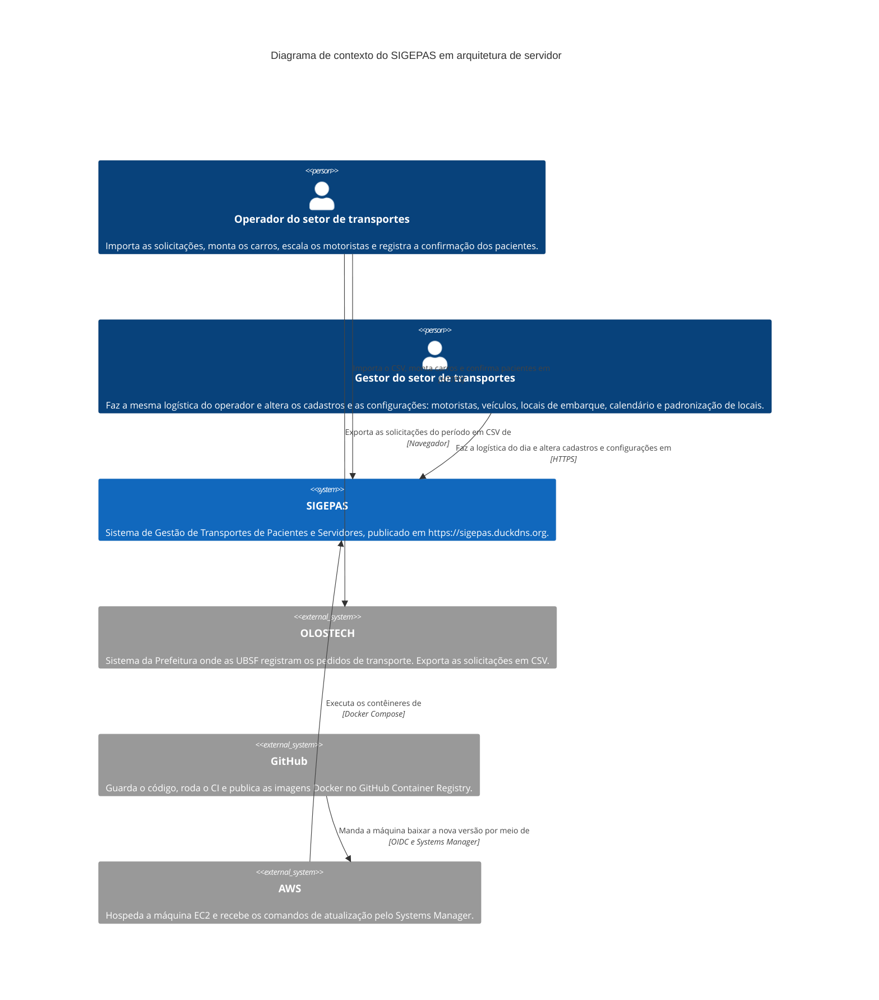

# C4, nível 1: contexto do SIGEPAS em arquitetura de servidor

## Visão geral

O SIGEPAS organiza o transporte de pacientes e servidores da Secretaria de Saúde de Joinville para tratamento fora do
município. Quem trabalha no setor de transportes, operador ou gestor, faz toda a logística. A pessoa importa o
arquivo de solicitações exportado do OLOSTECH. Depois, aloca cada paciente num carro, escala o motorista e registra a
confirmação feita por telefone. Na tela Configurações, só o gestor altera os cadastros e as configurações: motoristas,
veículos, locais de embarque, calendário e padronização de locais. Na revisão de locais da importação, qualquer pessoa
do setor grava a decisão sobre um local pendente no dicionário de padronização
([ADR 0019](../adr/0019-toda-a-logistica-e-de-quem-trabalha-no-setor.md)).

O sistema não tem integração automática com outro sistema. O arquivo do OLOSTECH chega pelas mãos de quem trabalha no
setor, que o baixa no OLOSTECH e o carrega na tela de importação.

## Diagrama

## Legenda

| Forma | Significado |
|---|---|
| Pessoa | Quem usa o sistema pelo navegador |
| Caixa azul-escura | O sistema descrito, o SIGEPAS |
| Caixa cinza | Sistema externo, fora do controle do projeto |
| Seta | Uma direção, com a intenção e o meio |

| Sigla | Significado |
|---|---|
| UBSF | Unidade Básica de Saúde da Família |
| CSV | Arquivo de texto com valores separados |
| CI | Integração contínua |
| OIDC | OpenID Connect, a troca de credencial de curta duração entre o GitHub e a AWS |
| EC2 | Máquina virtual da AWS |

## Elementos

| Nome | Tipo | Tecnologia | Responsabilidade |
|---|---|---|---|
| Operador do setor de transportes | Pessoa | Navegador | Organiza as viagens do dia |
| Gestor do setor de transportes | Pessoa | Navegador | Organiza as viagens e altera os cadastros e as configurações |
| SIGEPAS | Sistema | NestJS, React, PostgreSQL | Fila do dia, montagem dos carros, escala e confirmação |
| OLOSTECH | Sistema externo | Sistema da Prefeitura | Origem dos pedidos de transporte |
| GitHub | Sistema externo | GitHub Actions e GHCR | CI, imagens e disparo do deploy |
| AWS | Sistema externo | EC2, Systems Manager, IAM | Hospedagem |

## Relações principais

| De | Para | Intenção | Meio |
|---|---|---|---|
| Operador | OLOSTECH | Exporta as solicitações em CSV | Navegador |
| Operador | SIGEPAS | Importa o CSV, monta carros e confirma pacientes | HTTPS |
| Gestor | SIGEPAS | Faz a logística do dia e altera cadastros e configurações | HTTPS |
| GitHub | AWS | Manda a máquina baixar a nova versão | OIDC e Systems Manager |
| AWS | SIGEPAS | Executa os contêineres | Docker Compose |

## Decisões que aparecem neste nível

- **Sem integração automática com o OLOSTECH.** O sistema da Prefeitura não oferece interface para outro sistema ler
  os pedidos. O CSV exportado é a mesma entrada que o setor já usa hoje.
- **Dois sistemas com o mesmo nome.** O SIGEPAS em Apps Script, que o setor usa numa planilha, continua em uso. Este
  repositório é o SIGEPAS em arquitetura de servidor, construído para fim acadêmico. Os dois não trocam dados, e por
  isso o primeiro não aparece no diagrama.
- **Papéis do setor.** O operador e o gestor fazem toda a logística do dia. Só as alterações feitas na tela
  Configurações exigem o papel de gestor. As contas nascem pelo comando `criar-conta`, fora das telas
  ([ADR 0019](../adr/0019-toda-a-logistica-e-de-quem-trabalha-no-setor.md)).
- **Deploy sem SSH.** A máquina não tem porta 22 aberta. O GitHub assume um papel da AWS por OIDC e manda o comando
  pelo Systems Manager ([ADR 0006](../adr/0006-hospedagem-na-aws-com-terraform.md)).

## Premissas

- Só dados fictícios no ambiente publicado. Nenhum dado real de paciente entra no SIGEPAS em arquitetura de servidor.
- A remoção interna e os transportes dentro de Joinville ficam fora desta entrega e são melhoria futura
  ([ADR 0018](../adr/0018-terceiro-fluxo-e-a-confirmacao-do-paciente.md)).
- O domínio `sigepas.duckdns.org` e o certificado do Let's Encrypt são detalhes de implantação e aparecem no
  [diagrama de implantação](04-implantacao.md).

## Outros níveis

- Nível 2: [contêineres](02-conteineres.md)
- Nível 3: [componentes da API](03-componentes-da-api.md)
- Diagrama de apoio: [implantação na AWS](04-implantacao.md)
