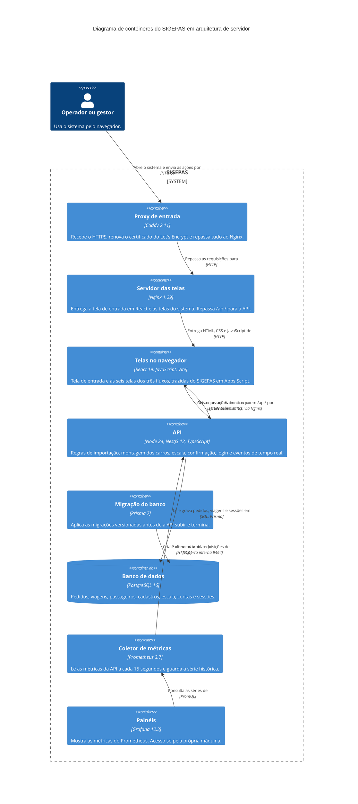

# C4, nível 2: contêineres do SIGEPAS

## Visão geral

O SIGEPAS roda em sete contêineres do Docker Compose, numa única máquina. O navegador fala só com o Caddy, que recebe
o HTTPS. Atrás dele, o Nginx entrega as telas e repassa as chamadas `/api/` para a API em NestJS. A API grava no
PostgreSQL e avisa as telas abertas pelo canal de tempo real. O Prometheus lê as métricas da API, e o Grafana mostra
essas métricas em painéis.

## Diagrama

## Legenda

| Forma | Significado |
|---|---|
| Pessoa | Quem usa o sistema |
| Caixa azul | Contêiner do SIGEPAS: um processo que sobe e para sozinho |
| Cilindro | Banco de dados |
| Moldura tracejada | Limite do sistema |
| Seta | Uma direção, com a intenção e o protocolo |

Siglas: HTTPS (HTTP com criptografia), SQL (linguagem do banco), PromQL (linguagem de consulta do Prometheus).

## Elementos

| Nome | Tipo | Tecnologia | Responsabilidade |
|---|---|---|---|
| Proxy de entrada | Contêiner | Caddy 2.11 | HTTPS, certificado, cabeçalho HSTS, compressão fora do canal de tempo real |
| Servidor das telas | Contêiner | Nginx 1.29 sem root | Arquivos estáticos, política de segurança de conteúdo, repasse de `/api/` |
| Telas no navegador | Contêiner | React 19 e JavaScript em módulos | Interface dos três fluxos, com `fetch` para a API |
| API | Contêiner | Node 24, NestJS 12 | Regras de negócio, autenticação, eventos |
| Migração do banco | Contêiner | Prisma 7 | `prisma migrate deploy` a cada atualização |
| Banco de dados | Contêiner de dados | PostgreSQL 16 | Persistência |
| Coletor de métricas | Contêiner | Prometheus 3.7 | Coleta das métricas da API |
| Painéis | Contêiner | Grafana 12.3 | Visualização das métricas |

## Relações principais

| De | Para | Intenção | Protocolo |
|---|---|---|---|
| Navegador | Caddy | Abre o sistema e envia as ações | HTTPS |
| Caddy | Nginx | Repassa as requisições | HTTP na rede interna |
| Telas | API | Chama as ações do sistema | JSON, `POST /api/<assunto>/<ação>` |
| API | Telas | Avisa que um dia mudou | Server-Sent Events em `/api/eventos` |
| API | PostgreSQL | Lê e grava | SQL pelo Prisma |
| Migração | PostgreSQL | Cria e altera as tabelas | SQL |
| Prometheus | API | Lê o contador de requisições | HTTP na porta 9464, fora da internet |
| Grafana | Prometheus | Consulta as séries | PromQL |

## Decisões que aparecem neste nível

- **Telas trazidas do Apps Script como módulos.** O HTML, o CSS e o JavaScript das seis telas foram reaproveitados.
  Cada `google.script.run` virou uma chamada `fetch` para a API ([ADR 0016](../adr/0016-porte-das-telas-e-tempo-real.md)).
- **Tempo real por Server-Sent Events.** Cada gravação gera um aviso com o dia que mudou. As outras telas abertas
  recarregam só aquele dia. A tela que gravou reconhece o próprio aviso pelo cabeçalho `X-Id-Da-Tela` e não recarrega.
- **Login com sessão no servidor.** O navegador guarda só um cookie `__Host-` HttpOnly com um código aleatório. O banco
  guarda o resumo SHA-256 desse código ([ADR 0015](../adr/0015-login-e-sessao-no-servidor.md)).
- **Migração separada da API.** A API só sobe depois de a migração terminar com sucesso, o que evita a API rodar contra
  tabelas antigas.
- **Métricas fora da internet.** A porta 9464 só existe na rede interna do Compose. O Nginx responde 404 para
  `/api/metrics`. O Prometheus e o Grafana só escutam em `127.0.0.1` da máquina.

## Premissas

- O Grafana é aberto por um túnel do Systems Manager até a porta 3001 da máquina. Não há acesso pela internet.
- A cópia de segurança do banco para o S3 ainda não existe.

## Outros níveis

- Nível 1: [contexto](01-contexto.md)
- Nível 3: [componentes da API](03-componentes-da-api.md)
- Diagrama de apoio: [implantação na AWS](04-implantacao.md)
