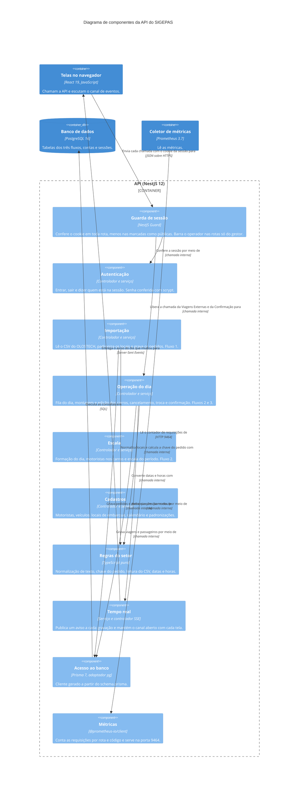

# C4, nível 3: componentes da API

## Visão geral

A API é um único processo NestJS. Cada assunto do setor tem um par controlador e serviço: o controlador recebe a
rota, e o serviço faz a regra e grava no banco. As regras puras, sem banco e sem framework, ficam num módulo separado e
são testadas sozinhas. A guarda de sessão roda antes de toda rota e barra quem não entrou.

## Diagrama

O diagrama mostra as relações de Importação e Operação, que são o caminho dos três fluxos. Escala e Cadastros seguem
o mesmo desenho: passam pela guarda, usam as regras do setor, gravam pelo Prisma e avisam o Tempo real.

## Legenda

| Forma | Significado |
|---|---|
| Caixa azul-clara | Componente dentro da API |
| Caixa azul | Outro contêiner do SIGEPAS |
| Cilindro | Banco de dados |
| Seta | Uma direção, com a intenção |

Siglas: SSE (Server-Sent Events), CSV (arquivo de valores separados).

## Elementos

| Nome | Tipo | Tecnologia | Responsabilidade | Pasta |
|---|---|---|---|---|
| Guarda de sessão | Componente | NestJS Guard global | Barra rota sem sessão e rota de gestor | `backend/src/autenticacao/` |
| Autenticação | Componente | NestJS, `node:crypto` | `entrar`, `sair`, `eu` | `backend/src/autenticacao/` |
| Importação | Componente | NestJS | CSV do OLOSTECH até a fila | `backend/src/importacao/` |
| Operação do dia | Componente | NestJS | Carros, passageiros e confirmação | `backend/src/operacao/` |
| Escala | Componente | NestJS | Motoristas nos carros | `backend/src/escala/` |
| Cadastros | Componente | NestJS | Motoristas, veículos, locais, calendário | `backend/src/cadastros/` |
| Regras do setor | Componente | TypeScript sem framework | Regras puras, testadas sem banco | `backend/src/regras/` |
| Tempo real | Componente | RxJS e `@Sse` do NestJS | Canal `GET /eventos` | `backend/src/tempo-real/` |
| Acesso ao banco | Componente | Prisma 7 | Cliente do PostgreSQL | `backend/src/banco-de-dados/` |
| Métricas | Componente | `@prometheus-io/client` | `sigepas_requisicoes_http_total` | `backend/src/metricas/` |

## Relações principais

| De | Para | Intenção | Meio |
|---|---|---|---|
| Telas | Guarda de sessão | Envia cada chamada com o cookie | JSON, corpo `{ "argumentos": [...] }` |
| Importação | Regras do setor | Normaliza locais e calcula a chave do pedido | Chamada de função |
| Operação do dia | Tempo real | Avisa que um dia mudou | Chamada de função |
| Tempo real | Telas | Entrega o aviso | Server-Sent Events |
| Acesso ao banco | PostgreSQL | Executa as consultas | SQL |

## Decisões que aparecem neste nível

- **Uma rota por ação.** Cada função do `codigo.gs` virou uma rota `POST /<assunto>/<ação>`, com os mesmos argumentos.
  As telas trazidas não precisaram mudar a forma das chamadas.
- **Trava por dia no banco.** Duas pessoas montando carros no mesmo dia não se atropelam: o serviço pede ao PostgreSQL
  uma trava do dia (`pg_advisory_xact_lock`) dentro da transação. Ela substitui o `LockService` do Apps Script.
- **Regras puras separadas.** O módulo de regras não importa NestJS nem Prisma. Por isso, os testes dele rodam sem
  banco e cobrem os casos-limite medidos nos dados do setor.
- **Proteção contra CSRF pela exigência de JSON.** As rotas que gravam só aceitam `Content-Type: application/json`, que
  um formulário de outro site não consegue enviar sem a permissão do navegador. O cookie também é `SameSite=Strict`.

## Premissas

- Os nomes de componente seguem as pastas do código em 26/11/2026. Se uma pasta mudar de nome, este documento muda
  no mesmo PR.

## Outros níveis

- Nível 1: [contexto](01-contexto.md)
- Nível 2: [contêineres](02-conteineres.md)
- Diagrama de apoio: [implantação na AWS](04-implantacao.md)
